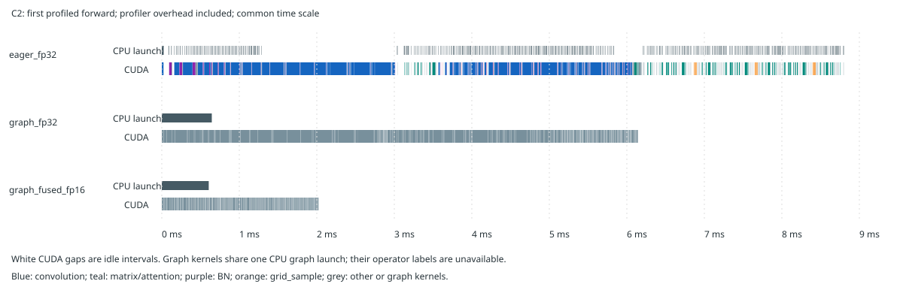

# RTX 5090：7.4 ms 的算子与运行时诊断

2026-10-25，Asia/Shanghai；分支 `5090-detrscope-query-budget`。第一优先级推理诊断；未训练、未改 Query 或 Sampling Points。

C2 独立进程复测原生未融合 FP32 为 **7.345 ms**。CUDA Graph 未融合 FP32 为 **6.051 ms**（延迟下降 17.6%）；融合 FP16 + Graph 为 **1.916 ms**（下降 73.9%）。这证明运行时与精度路径值得优先处理，同时 FP32 卷积仍是真实的大头。低精度与部署输出仅做 smoke 核验，不能承诺 AP 保持。

部署独立同轮对照：融合Eager FP32 **7.022 ms**，TensorRT FP32 **2.346 ms**，TensorRT FP16 **0.860 ms**。相同数学结构已能获得很大收益，建议先固定部署执行路径，再做Sampling Points的纯速度筛选。

## 测量口径与原始 7.4 ms 的关系

使用原 C0/C2 150e seed0 的 best.pt、原先同一张真实验证图，batch1、RGB 640×640、300Q、3 Decoder 层、8头、3尺度、每尺度4采样点。GPU输入/输出常驻；不含图片读取、预处理、H2D/D2H、后处理或NMS。输入与权重SHA、运行时源码SHA及环境均在 [identity.json](raw/identity.json)。

PyTorch 2.14.0+cu130，RTX 5090 D v2 24GB，4 CPU线程，seed=20261024，TF32关闭，cuDNN benchmark关闭，inference_mode。每条件先预热150次；5轮随机交错条件，每块10次预热+50次计时，共250次。CUDA Event和同步到结束事件的CPU wall时间同时保留；无profiler、无module hook。Graph仅测replay，捕获不计时。

C0采用首个模型的独立初始状态；C2另开独立进程复核，避免跨模型顺序/常驻对象影响。探索双模型同进程的C2曾为7.798 ms，该值不进入最终表；独立C2五轮FP32均值稳定约7.34 ms。不能将不同进程的C0/C2差值解释为结构收益。

## 无 profiler 的整网性能

| 路径 | C0 mean ms | C2 mean ms | C2 p95 ms | C2 wall mean ms | C2延迟下降 |
|---|---:|---:|---:|---:|---:|
| Eager FP32 | 7.362 | 7.345 | 7.374 | 7.356 | 0.0% |
| Eager FP16 | 5.146 | 5.048 | 5.102 | 5.059 | 31.3% |
| Eager BF16 | 5.161 | 5.059 | 5.143 | 5.070 | 31.1% |
| 融合 FP32 | 6.922 | 6.925 | 6.952 | 6.936 | 5.7% |
| 融合 FP16 | 3.895 | 3.847 | 3.906 | 3.858 | 47.6% |
| 融合 BF16 | 3.888 | 3.868 | 3.924 | 3.880 | 47.3% |
| Graph FP32（未融合） | 6.034 | 6.051 | 6.062 | 6.059 | 17.6% |
| Graph + 融合 FP32 | 5.745 | 5.766 | 5.779 | 5.774 | 21.5% |
| Graph + 融合 FP16 | 1.893 | 1.916 | 1.920 | 1.924 | 73.9% |

融合包含 Conv-BN 折叠与 RepConv 重参数化；原生69个BN全部消除。框架原生 model.fuse() 留下3个Decoder输入投影BN，额外的Sequential Conv-BN折叠单列在原始记录 stock_fusion_probe 与 fusion 字段；两者不能混称为同一种融合。FP16/BF16采用整模型与输入转换，autocast=False；Graph低精度为FP16。

原生Graph捕获失败：AIFI在CPU创建位置编码并上传，Head也在CPU创建batch索引。诊断适配器在CUDA默认device上下文内运行捕获，固定形状常量在GPU生成；未改变参数、结构或预算。GPU三角函数舍入使适配FP32与原生最大绝对差约6e-6，Graph与其自身Eager输出逐值相同；输入乘0.75后也逐值一致。Graph适配不是已集成的动态部署接口，应用新输入仍需填充固定buffer。

## CUDA Timeline 与 CPU 提交

上图展示各路径首个profiler forward，CPU launch与GPU kernel使用同一横轴。可悬停SVG条块查看算子。完整Chrome trace只保留在服务器，可用Perfetto或chrome://tracing打开；路径、大小、SHA见每个profile JSON的trace字段。仓库保留 [逐kernel紧凑timeline](raw/timeline-c2.csv) 与 [CPU算子/模块时间](raw/cpu-c2.csv)。

| C2 profiler路径 | kernels/forward | kernel忙碌 ms | GPU首末kernel跨度 ms | 跨度内空档 | CPU提交间隔median/p95 µs |
|---|---:|---:|---:|---:|---:|
| Eager FP32 | 505 | 5.964 | 8.522 | 30.0% | 10.56/20.32 |
| Eager + module hooks | 505 | 5.968 | 10.563 | 43.5% | 16.31/33.03 |
| 融合 FP32 | 457 | 5.677 | 8.006 | 29.1% | 6.72/19.44 |
| Graph FP32 | 526 | 5.956 | 6.147 | 3.1% | 单次Graph launch |
| Graph融合FP16 | 591 | 1.892 | 2.020 | 6.4% | 单次Graph launch |

profiler同时采CPU/CUDA，每路径3次forward，关闭shape/stack/memory追踪。无标签采样负责整体kernel/空档统计；另一轮module hooks负责归属。CPU列是含子调用的inclusive时间，不能把父子项相加。CPU发射间隔可能含CPU计算、同步和驱动等待，并非纯Python耗时。CUDA表按runtime correlation将每个kernel归属一次，避免卷积父算子与cuDNN子算子重复计时。

**不能将profiler内空档比例直接代入原生7.345 ms。** profiler及module hooks本身放大CPU开销；模块标签路径空档更多。7.345→6.051 ms的无profiler同精度控制才是提交开销的实际收益证据（约1.294 ms）。Graph还改变常量生成的位置，故这不是严格的纯Python耗时测量。

Graph未融合FP32的kernel数没有减少，Graph只压缩提交空档；FP16 cuDNN可能拆出更多kernel，数量本身不代表慢。FP32卷积仍需真正执行，不能把全部7.4 ms归因Python。GPU空档按首末kernel区间做时间并集；不包含forward起止边界、memcpy或memset。

## GPU 算子花在哪里

C2无module标签profiler平均GPU kernel忙碌 **5.964 ms**；其中卷积 **4.360 ms**，占kernel总时长约 **73.1%**。这里是GPU kernel时间，不能当成原生forward独立逐项相加到7.4 ms。

| 算子组 | kernels/forward | CUDA kernel ms/forward |
|---|---:|---:|
| convolution | 107 | 4.3602 |
| matmul_linear_attention | 90 | 0.7726 |
| other | 161 | 0.3057 |
| batch_norm | 69 | 0.2995 |
| grid_sample | 9 | 0.0703 |
| activation | 30 | 0.0458 |
| layer_norm | 12 | 0.0377 |
| concat_stack | 9 | 0.0375 |
| copy_layout | 9 | 0.0145 |
| softmax | 7 | 0.0137 |
| upsample | 2 | 0.0062 |

| C2模块（独占kernel归属） | kernels/forward | CUDA kernel ms/forward |
|---|---:|---:|
| model.0:ResNet18Stem | 10 | 0.3477 |
| model.1:ResNet18Stage | 16 | 0.3378 |
| model.2:ResNet18Stage | 17 | 0.4477 |
| model.3:ResNet18Stage | 17 | 0.6543 |
| model.4:ResNet18Stage | 26 | 0.9560 |
| model.5:Conv | 2 | 0.0356 |
| model.6:AIFI | 28 | 0.1352 |
| model.7:Conv | 3 | 0.0206 |
| model.8:Upsample | 1 | 0.0020 |
| model.9:Conv | 2 | 0.0238 |
| model.10:Concat | 1 | 0.0020 |
| model.11:RepC3 | 40 | 0.3557 |
| model.12:Conv | 3 | 0.0253 |
| model.13:Upsample | 1 | 0.0042 |
| model.14:Conv | 3 | 0.0617 |
| model.15:Concat | 1 | 0.0078 |
| model.16:RepC3 | 33 | 0.5551 |
| model.17:Conv | 3 | 0.2039 |
| model.18:Concat | 1 | 0.0020 |
| model.19:RepC3 | 40 | 0.3488 |
| model.20:Conv | 3 | 0.1487 |
| model.21:Concat | 1 | 0.0015 |
| model.22:RepC3 | 40 | 0.2229 |
| model.24:RTDETRDecoder | 213 | 1.0676 |

Neck/Encoder的层5–23不等于单个RepC3。四个RepC3中P3层16最大；AIFI的Attention（model.6.ma）、FFN（fc1/fc2/GELU）及LayerNorm均已分开，详见下面表格。P2层14为160×160输入到80×80的3×3步长2卷积，不是将整个P3 RepC3成本都归给P2。C0与C2的P3融合通道也不同，禁止只凭两网差值给P2归因。

| AIFI子模块 | CUDA kernel ms/forward |
|---|---:|
| model.6.ma:MultiheadAttention | 0.0652 |
| model.6.fc2:Linear | 0.0384 |
| model.6.fc1:Linear | 0.0159 |
| model.6:AIFI | 0.0070 |
| model.6.norm1:LayerNorm | 0.0046 |
| model.6.norm2:LayerNorm | 0.0026 |
| model.6.act:GELU | 0.0015 |

Neck层5–23按算子组再分解（同一module标签采样；为kernel忙碌时间，不是旧2.609 ms的CUDA流跨度）：

| Neck算子组 | CUDA kernel ms/forward |
|---|---:|
| activation | 0.0457 |
| batch_norm | 0.1005 |
| concat_stack | 0.0133 |
| convolution | 1.8215 |
| copy_layout | 0.0053 |
| layer_norm | 0.0052 |
| matmul_linear_attention | 0.1051 |
| other | 0.0510 |
| softmax | 0.0032 |
| upsample | 0.0062 |

| RepC3层 | Conv ms | BN ms | 激活 ms | 其他 ms |
|---|---:|---:|---:|---:|
| 11 | 0.3217 | 0.0182 | 0.0080 | 0.0079 |
| 16 | 0.4951 | 0.0324 | 0.0137 | 0.0139 |
| 19 | 0.3150 | 0.0178 | 0.0081 | 0.0079 |
| 22 | 0.1933 | 0.0163 | 0.0070 | 0.0063 |

[RepC3各层Conv/BN/激活交叉表](layer-operators-c2.csv) · [完整算子表](operators-c2.csv) · [完整模块表](layers-c2.csv)。复制、布局变换与小逐元素算子也保留，未隐藏在Attention的总和中。注意MultiheadAttention部分工作由函数式linear完成，归属ma而非其未直接调用的out_proj模块。

本次没有采SM吞吐或DRAM硬件计数器，不能据此断言所有卷积是算力受限还是带宽受限。FP32关闭TF32、低精度大幅加速、Graph同精度仍有收益，支持先优化数值执行路径、融合与提交，再评估结构改动。

## ONNX / TensorRT

独立进程中的原生融合FP32作为同轮桥接基准；不得把部署进程和上面runtime进程的亚百分比差异当收益。固定shape ONNX opset17，最终框/分数[1,300,14]，torch.onnx legacy导出期间关闭MHA fastpath，之后恢复。ONNX I/O binding与TensorRT execute_async_v3使用与CUDA Event相同的stream及GPU常驻地址，导出/build不计时。TensorRT关闭TF32；FP16 flag允许内部FP16/FP32混合，不声称全算子FP16。

| 模型 | 部署路径 | mean ms | p95 ms | wall mean ms | 相对同轮融合FP32延迟下降 |
|---|---|---:|---:|---:|---:|
| C2 | eager_fused_fp32 | 7.022 | 7.063 | 7.033 | 0.0% |
| C2 | onnx_cuda_fp32 | 6.562 | 6.671 | 6.572 | 6.5% |
| C2 | trt_fp32 | 2.346 | 2.356 | 2.354 | 66.6% |
| C2 | trt_fp16 | 0.860 | 0.865 | 0.868 | 87.7% |

| C2部署profiler路径 | kernels/forward | GPU kernel忙碌 ms | GPU首末kernel跨度 ms |
|---|---:|---:|---:|
| eager_fused_fp32 | 457 | 5.696 | 8.249 |
| onnx_cuda_fp32 | 551 | 5.602 | 6.502 |
| trt_fp32 | 215 | 2.155 | 2.381 |
| trt_fp16 | 183 | 0.707 | 0.872 |

TensorRT FP32不仅减少CPU发射，也缩短GPU kernel忙碌时间；kernel名称包含FP32 Winograd及NHWC卷积实现。这提示后端tactic、布局与融合也比直接改Query/采样预算更值得先验证，不能把全部部署收益归因Python。具体kernel名称与次数保留在deployment profile JSON中。

最终部署使用非默认CUDA stream；早期默认stream的额外同步警告已消除。TensorRT FP16构建仍出现6个Constant超FP16范围并裁剪到±65504的警告，输出虽finite，仍需正式AP/数值验证。ONNX EP设备注册警告、旧包安装失败及恢复方式见 [后端记录](raw/backend_notes.json)，不隐去这些负面证据。

ONNX必须实际启用CUDAExecutionProvider；禁止静默用CPU结果冒充GPU。CPU EP可执行形状控制等小操作，实际CUDA kernel trace与后端provider配置均归档。权重、ONNX、engine、完整trace与inspector JSON只留服务器，报告JSON记录路径/大小/SHA。

## 数值检查与解释边界

没有重新训练、没有重跑完整COCO评估。原有FP32正式AP记录仍属于原协议；本次FP16/BF16/TensorRT结果只用于性能。每条路径核验输出shape及finite；Graph额外核验与自身Eager逐值相同及更换输入。融合/低精度/部署对原生FP32的max/mean绝对差保存在各condition中。低精度会改变Top-K排序，逐query槽位差异可能很大，不能把该max差当定位退化，也不能据输出finite声称保AP。

固定单图和静态形状不代表548图端到端延迟分布或动态batch吞吐；显存peak含常驻模型/Graph池，不能当单模型部署需求。此处选择Graph满足运行时对照，未额外测torch.compile。channels_last、TF32、cuDNN autotune与生产输入管理尚未调优，不声称1.9 ms已经是全局最优。

## 对第二优先级的结论

当前9个grid_sample kernel合计仅 **0.0703 ms**；它不包含MSDeformAttn的value/output投影、offset、weight与reshape等全部成本，不能把它当整个MSDeformAttn，也不能用它直接推算真实减点收益。现阶段先固定融合/低精度/Graph或TensorRT路径，再做用户提出的随机兼容模块速度筛选才有解释力。**本次未开展Sampling Points性能实验或训练。**

## 复现与云端校验

复测依赖identity.json列出的服务器checkpoint及同一验证图/标注；离线报告重建、哈希与相对链接检查只需仓库，不访问这些资产。复现命令与资产边界见 [入口README](README.md)。报告由 [report_runtime_5090.py](../../../experiments/decoder_budget_5090/report_runtime_5090.py) 基于raw文本生成。
