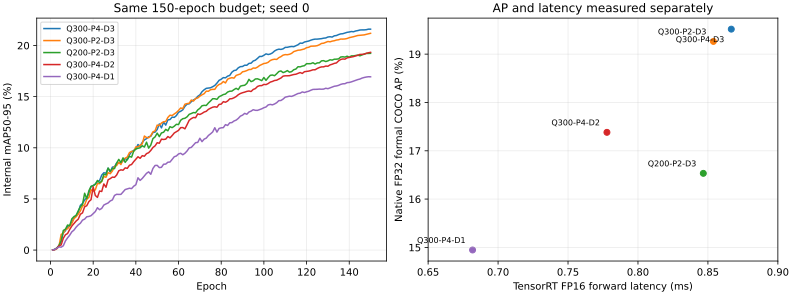

# 5090：四组从零训练最终结果

分支 `5090-detrscope-query-budget`；实验 `5090-c2-fresh-four-20261025-s0-r1`。2026-10-26 14:20（北京时间）全部完成：四组各150轮、548图正式FP32 COCO评估、TensorRT测速；另已完成五模型同场交错复测。无旧checkpoint初始化或微调。

[完整分析](REPORT.md) · [可读对照数据](comparison.csv) · [完整训练曲线](training_curves.csv) · [最终状态和原始自动评估证据](../../../reports/5090/fresh_budgets/experiments.json)

| 模型 | 正式FP32 AP | 相对原C2/AP点 | TRT FP16延迟 | 延迟下降 |
|---|---:|---:|---:|---:|
| 原C2：300Q/P4/D3 | 19.517 | — | 0.8667 ms | — |
| 300Q/P2/D3 | 19.263 | −0.254 | 0.8539 ms | 1.47% |
| 200Q/P2/D3 | 16.533 | −2.984 | 0.8467 ms | 2.31% |
| 300Q/P4/D2 | 17.381 | −2.135 | 0.7778 ms | 10.26% |
| 300Q/P4/D1 | 14.947 | −4.570 | 0.6818 ms | 21.34% |

AP单位为百分制，差为百分点；延迟是batch1、640、GPU常驻纯forward，未含预处理/传输/后处理。FP16只测性能，没有评估FP16 AP。原C2是之前同配方150轮seed0训练固定的checkpoint，本次统一重测其速度；本次只重训用户指定的四个候选。

300Q减点接近原精度但省时小；联合减少Query当前不划算。D2/D1有明显速度收益，但从零训练的精度损失远大于旧D3模型提前退出时的损失。后期曲线仍上升，当前结论限于150轮同预算、单seed，尚不能声称已达到结构收敛上限。



证据采用可读文本，权重、完整日志、数据集、预测及导出engine保留服务器：

- [同场测速15000次CUDA样本](raw/paired_benchmark.json)：20轮随机交错，保存每轮wall摘要；FP32/FP16等三执行路径，checkpoint和engine身份可追溯。
- [600轮健康采样](raw/training_health.csv)、[50组类别AP及尺度指标](raw/category_ap.csv)、[按同GT对照的类别/尺度得失](raw/gt_transitions.csv)。
- [服务器资产路径/大小/SHA256与COCO重放回执](raw/server_artifacts.json)；最终checkpoint路径/SHA也在最终状态JSON中。
- [从零训练配置、初始化证据、数据审计及复现命令](../2026-10-25_5090_fresh_decoder_training/README.md)；[前期性能筛选与旧模型逐层评估](../2026-10-25_5090_decoder_screen/README.md)。

报告和校验从Git检出后的文本即可运行，不读取服务器独有权重/数据：

```bash
python3 -m experiments.decoder_budget_5090.report_fresh_results_5090 --verify
python3 -m experiments.decoder_budget_5090.report_fresh_results_5090 --output /tmp/5090-final-replay
```

绘图可加 `--plots`，需matplotlib。`MANIFEST.sha256`只包含随仓库提供的文件。最终自动快照JSON约1.3 MiB，包含四组完整曲线、训练身份及自动评估CUDA/wall原始计时，保留它以支持独立阅读与离线重建；本归档不重复拷贝该快照。
