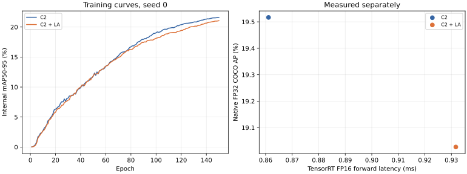

# 5090：C2＋局部注意力从零150轮结果

分支 `5090-detrscope-query-budget`。新组合完整150轮及548图正式评估已完成；已有C2基线未重训。训练于2026-10-27 04:29（北京时间）结束；TensorRT环境修复后已对两个训练好的模型同场补测。

[完整分析](REPORT.md) · [原生FP32精度](accuracy.csv) · [TensorRT FP16精度](accuracy_trt_fp16.csv) · [时延表](latency.csv) · [完整训练曲线](training_curves.csv)

| 指标 | 原C2 | C2＋局部注意力 | 变化 |
|---|---:|---:|---:|
| 原生FP32 COCO AP | 19.517 | 19.027 | −0.490点 |
| TensorRT FP16 COCO AP | 19.476 | 18.939 | −0.537点 |
| APs | 12.653 | 12.390 | −0.263点 |
| APm | 26.698 | 26.613 | −0.086点 |
| APl | 34.665 | 31.191 | −3.474点 |
| TensorRT FP16纯forward | 0.8611 ms | 0.9317 ms | 慢8.20% |

精度为百分制、差为百分点；TensorRT FP16也已在完整548图上正式评估。单seed、同样150轮预算下，当前组合没有带来精度或速度收益；后25轮内部mAP仍在上升，尚不能宣称训练充分收敛。



第一次自动部署测速因控制器把虚拟环境Python符号链接解析成基础解释器，四个TensorRT条件失败。修正调用后重新加载**训练好的两个checkpoint**并同场测20轮×50次；原失败记录保留服务器及[验证摘要](raw/validation.json)，不覆盖。原生FP32 COCO结果不受此次测速失败影响。

- [新模型150轮训练状态、配置和checkpoint路径/SHA](raw/training.json) · [150轮健康](raw/training_health.csv) · [原生FP32正式评估与类别](raw/evaluation.json) · [TensorRT FP16正式评估](raw/trt_fp16_coco.json)。
- [补测原始CUDA样本和环境](raw/benchmark.json) · [完成状态与阶段](raw/status.json) · [服务器文件路径/大小/SHA和失败原因](raw/validation.json)。权重、预测、ONNX/engine和完整日志仅服务器保留。
- [实验启动记录和复现](../2026-10-26_5090_c2_la_150e_launch/README.md) · [历史C2逐层正式精度](../2026-10-25_5090_decoder_screen/README.md) · [训练前GPU预检](../2026-10-26_5090_p2_p5_la_preflight/README.md)。

从Git文本离线验证和重建结果，不依赖GPU、数据集或权重：

```bash
python3 -I docs/experiment_reports/2026-10-27_5090_c2_la_150e_results/verify.py
python3 -m experiments.p2_p5_la_5090.archive_joint_results --output /tmp/5090-joint-final-replay
# 可在安装matplotlib的环境中加 --plots 重建图表。
```

训练模型的TensorRT复测依赖实验服务器、历史C2及新组合checkpoint和正确的TensorRT虚拟环境。`MANIFEST.sha256`只列随仓库提供的文件；完整预测、模型和引擎不提交。
