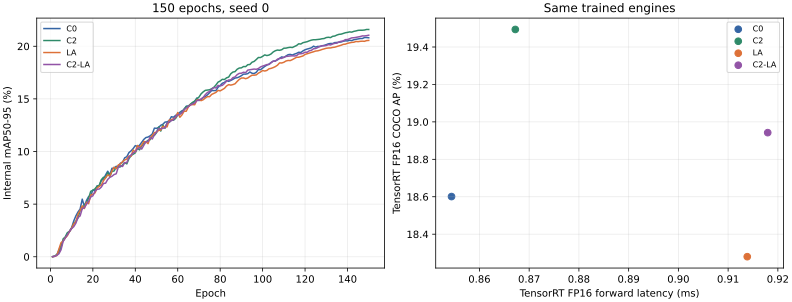

# LA-only从零150轮：5090四组对照结果

分支 `5090-detrscope-query-budget`。唯一新训LA-only；已有C0、C2、C2＋LA训练与权重均复用。全部150轮、原生完整COCO评估、四模型同场测速及四引擎FP16完整COCO评估于2026-10-27 18:03（北京时间）完成。

**本次seed0、150轮下，LA-only没有优于C0：原生AP低0.350点，TensorRT FP16延迟高6.96%。** 给LA加入P2后原生AP增加0.715点，但仍低于原C2。

## 四组同协议比较

精度为完整548张验证图、38759个标注的正式COCO bbox AP，表中乘100；conf=.001，每query取最高类、最多300预测、不做NMS/坐标舍入，COCO maxDets=[1,10,100]。原生未融合FP32为batch2，TensorRT FP16引擎为batch1，输入输出为FP32且引擎允许混合精度。延迟为训练后四模型同场GPU常驻batch1、640纯forward，不含预处理/传输/后处理。

| 模型 | 原生FP32 AP | 原生APs | TensorRT FP16 AP | TensorRT FP16 ms |
|---|---:|---:|---:|---:|
| c0 | 18.662 | 12.166 | 18.601 | 0.8544 |
| c2 | 19.517 | 12.653 | 19.494 | 0.8672 |
| la | 18.311 | 12.086 | 18.280 | 0.9138 |
| c2-la | 19.027 | 12.390 | 18.942 | 0.9180 |

TensorRT FP16四个实际引擎均在相同548图上完成正式AP评估；四份未舍入预测由独立DETRScope COCO评估器重放，12项指标误差均小于1e-12。[原始FP16结果和别名映射](raw/fp16-c0-la.json) · [另一对](raw/fp16-c2-joint.json) · [独立重放](raw/replay.json)。

## 改动的实际效果

- **单独加LA（C0→LA）**：原生AP -0.350点，APs -0.080点；FP16延迟上升6.96%（0.8544→0.9138 ms）。
- **已有P2时加LA（C2→C2＋LA）**：原生AP -0.490点，APs -0.263点；FP16延迟上升5.85%。
- **LA上加P2（LA→C2＋LA）**：原生AP +0.715点，APs +0.304点；FP16延迟上升0.45%。
- **P2与LA的交互**：AP交互项 -0.140点、APs交互项 -0.182点，计算式为组合−C2−LA＋C0。这是单seed点估计，不能视作统计显著。

LA-only的大目标APl比C0高3.499点，但APm与总体AP下降；组合相对C2的大目标APl下降3.474点。分类别看，LA-only相对C0有8类下降、2类上升：bus下降1.752点，自行车和van分别增加0.577、0.602点；bus仅有251个验证标注，单seed下不应过度解释。不同尺度及类别的反应并不一致，无法仅凭总体AP推断原因。[完整文本表](category_metrics.csv)保留四组原生与FP16结果。

FP16延迟95%区间按20个配对轮次重采样，仅描述本次计时波动，不覆盖重新构建TensorRT引擎、其他图片或设备差异。此前单独C2对组合测速约慢8.20%，本次四模型同场约慢5.85%；两次使用独立构建的引擎与独立测量，不能把某个百分比当成跨构建的固定值。两次方向一致。[完整配对差及区间](latency_effects.csv)。

TensorRT构建日志记录24条FP16常量裁剪和2条LayerNorm相关警告；上述FP16精度是这些实际引擎在完整验证集上的测量。

## 训练与有效范围

LA-only从零训练150轮、seed0、batch8、640、FP32、AdamW及原配方；训练计算累计5.82小时，PyTorch峰值allocated 14030 MiB。最佳内部mAP出现在第150轮；125→150轮增加1.009点。P5 QKV/RPB梯度全程非零，检测框更新有限。

历史C0/C2/C2＋LA是独立完成的150轮训练，没有为本次对照重跑。共同数据、配方、seed及随机初值已核验；由于代码执行/训练存在非确定性且只有单seed，效应和交互仅为本次固定预算估计，尚不证明充分收敛。



目前实际权衡下，C2在本次FP16测量中比LA-only和C2＋LA同时具有更高AP和更低延迟；继续使用C2更稳妥。是否存在其他训练策略或更快局部注意力实现，需要另行实验。

## 可读证据与复现

- [四模型AP/参数/时延](comparison.csv)、[效应和交互](effects.csv)、[完整训练曲线](training_curves.csv)、[150轮健康](raw/training_health.csv)。
- [LA原生COCO和分类别](raw/evaluation.json)、[训练后12000次CUDA计时](raw/benchmark.json)、[FP16两对结果及显式别名](raw/fp16-c0-la.json)、[另一对](raw/fp16-c2-joint.json)、[独立重放](raw/replay.json)。
- [最终训练/权重路径及SHA](raw/training.json)、[执行状态](raw/status.json)、[服务器文件路径/大小/SHA及构建警告](raw/validation.json)。权重、预测、导出模型和完整日志仅服务器保存。
- [启动计划与复现](../2026-10-27_5090_la_only_150e_launch/README.md)、[既有C2＋LA结果](../2026-10-27_5090_c2_la_150e_results/README.md)。

从Git检出后，可不访问GPU、数据集或服务器权重运行：

```bash
python3 -I docs/experiment_reports/2026-10-27_5090_la_only_150e_results/verify.py
python3 -m experiments.p2_p5_la_5090.archive_la_only_results --output /tmp/5090-la-final-replay
# 可在有matplotlib的环境中加 --plots 重建SVG。
```
