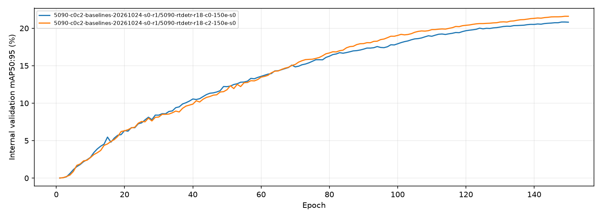
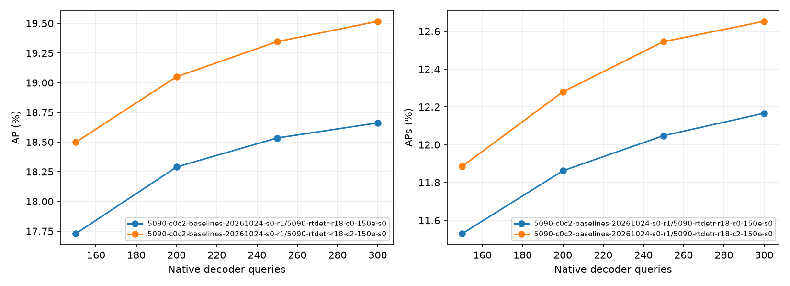
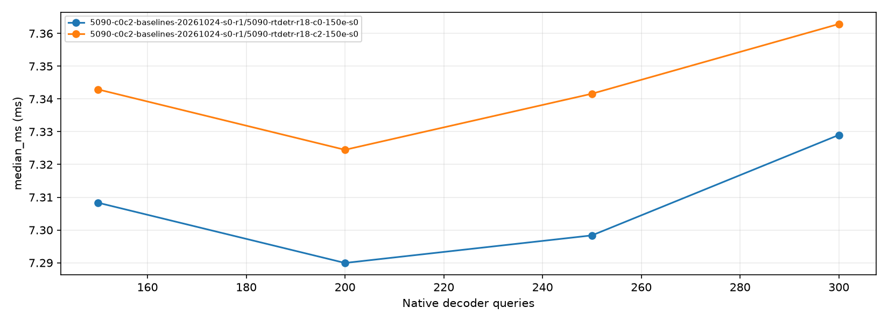

# 5090 RT-DETR 实验汇总

更新时间：2026-10-25T12:11:51.428199+08:00

[CSV](experiments.csv) · [JSON](experiments.json) · [Excel](experiments.xlsx) · [产物校验](MANIFEST.sha256)

由 `experiments/decoder_budget_5090/report_5090.py` 自动扫描生成。正式COCO指标以百分数显示，Δ为相对同一checkpoint的300Q基线的百分点；JSON/CSV保留0–1原始指标。
内部Precision/Recall/mAP仅描述训练日志。完整验证、8图门禁和1轮短跑分别展示；失败/中断后残留的评估标为stale，不进入主结果。
不同checkpoint不直接计算Query压缩差值。单seed与单次计时不证明稳定收益；完整训练150轮不等于证明收敛。

## 主结果：完整验证集

| 实验 / Run | Q | 图像 | 状态 | AP | AP50 | AP75 | APs | APm | APl | ΔAP (pp) | ΔAPs (pp) | 平均GPU延迟 ms | GPU FPS |
|---|---:|---:|---|---:|---:|---:|---:|---:|---:|---:|---:|---:|---:|
| 5090-c0c2-baselines-20261024-s0-r1/5090-rtdetr-r18-c0-150e-s0 | 300 | 548 | completed | 18.66 | 32.50 | 18.07 | 12.17 | 25.96 | 29.23 | 0.00 | 0.00 | 7.332 | 136.39 |
| 5090-c0c2-baselines-20261024-s0-r1/5090-rtdetr-r18-c0-150e-s0 | 250 | 548 | completed | 18.53 | 32.21 | 17.93 | 12.05 | 25.78 | 28.96 | -0.13 | -0.12 | 7.299 | 137.01 |
| 5090-c0c2-baselines-20261024-s0-r1/5090-rtdetr-r18-c0-150e-s0 | 200 | 548 | completed | 18.29 | 31.62 | 17.70 | 11.86 | 25.37 | 28.45 | -0.37 | -0.30 | 7.293 | 137.11 |
| 5090-c0c2-baselines-20261024-s0-r1/5090-rtdetr-r18-c0-150e-s0 | 150 | 548 | completed | 17.73 | 30.38 | 17.33 | 11.53 | 24.54 | 28.02 | -0.93 | -0.64 | 7.311 | 136.78 |
| 5090-c0c2-baselines-20261024-s0-r1/5090-rtdetr-r18-c2-150e-s0 | 300 | 548 | completed | 19.52 | 33.49 | 19.15 | 12.65 | 26.70 | 34.67 | 0.00 | 0.00 | 7.363 | 135.82 |
| 5090-c0c2-baselines-20261024-s0-r1/5090-rtdetr-r18-c2-150e-s0 | 250 | 548 | completed | 19.35 | 33.13 | 19.03 | 12.55 | 26.52 | 34.40 | -0.17 | -0.11 | 7.343 | 136.19 |
| 5090-c0c2-baselines-20261024-s0-r1/5090-rtdetr-r18-c2-150e-s0 | 200 | 548 | completed | 19.05 | 32.53 | 18.78 | 12.28 | 26.09 | 34.28 | -0.47 | -0.37 | 7.327 | 136.49 |
| 5090-c0c2-baselines-20261024-s0-r1/5090-rtdetr-r18-c2-150e-s0 | 150 | 548 | completed | 18.50 | 31.37 | 18.35 | 11.89 | 25.37 | 34.08 | -1.02 | -0.77 | 7.346 | 136.13 |

## 计时与候选覆盖

计时为未融合FP32、batch1、50次预热/200次CUDA Event、无observer的GPU整网forward，不含传输/预处理/后处理；不是Decoder单独或端到端延迟。GPU FPS=1000/原始计时样本的平均延迟(ms)，不是中位延迟倒数或逐样本FPS的平均；没有计时样本时不估算FPS。Coverage为Encoder候选多对多GT覆盖，不是COCO召回/AP。

| 实验 / Run | Q | 平均延迟 ms | 中位延迟 ms | P95 ms | GPU FPS | 峰值allocated MiB | Coverage@.5 | 正确类Coverage@.5 |
|---|---:|---:|---:|---:|---:|---:|---:|---:|
| 5090-c0c2-baselines-20261024-s0-r1/5090-rtdetr-r18-c0-150e-s0 | 300 | 7.332 | 7.329 | 7.369 | 136.39 | 212.90 | 78.68 | 65.39 |
| 5090-c0c2-baselines-20261024-s0-r1/5090-rtdetr-r18-c0-150e-s0 | 250 | 7.299 | 7.298 | 7.328 | 137.01 | 212.90 | 77.28 | 64.25 |
| 5090-c0c2-baselines-20261024-s0-r1/5090-rtdetr-r18-c0-150e-s0 | 200 | 7.293 | 7.290 | 7.329 | 137.11 | 212.90 | 74.98 | 62.43 |
| 5090-c0c2-baselines-20261024-s0-r1/5090-rtdetr-r18-c0-150e-s0 | 150 | 7.311 | 7.308 | 7.337 | 136.78 | 212.90 | 71.48 | 59.59 |
| 5090-c0c2-baselines-20261024-s0-r1/5090-rtdetr-r18-c2-150e-s0 | 300 | 7.363 | 7.363 | 7.388 | 135.82 | 219.31 | 79.12 | 65.98 |
| 5090-c0c2-baselines-20261024-s0-r1/5090-rtdetr-r18-c2-150e-s0 | 250 | 7.343 | 7.342 | 7.368 | 136.19 | 219.31 | 77.62 | 64.77 |
| 5090-c0c2-baselines-20261024-s0-r1/5090-rtdetr-r18-c2-150e-s0 | 200 | 7.327 | 7.324 | 7.356 | 136.49 | 219.31 | 75.43 | 63.03 |
| 5090-c0c2-baselines-20261024-s0-r1/5090-rtdetr-r18-c2-150e-s0 | 150 | 7.346 | 7.343 | 7.375 | 136.13 | 219.31 | 71.85 | 60.18 |

## 5090 分段延迟与瓶颈评估

固定一张真实验证图；未融合FP32、batch1、640，先预热150次，再做5轮交错顺序，每条件每轮10次预热/50次计时。分段与无标记原生forward分别采样；每条件每模式250次。此处为独立测量，不替换上方200次整网计时。
同一次forward内设置CUDA Event边界，分段之和逐次核对整网；包含CPU提交导致的CUDA流空隙，不等于纯GPU内核忙碌时间，不含传输/预处理/后处理。

| 阶段（300Q） | C0 ms | C0占比 | C2 ms | C2占比 |
|---|---:|---:|---:|---:|
| Backbone（层0–4） | 2.919 | 39.6% | 2.921 | 39.3% |
| Neck/Encoder（层5–23） | 2.554 | 34.7% | 2.609 | 35.1% |
| Head输入投影与Query选择 | 0.363 | 4.9% | 0.359 | 4.8% |
| Decoder与预测头 | 1.501 | 20.4% | 1.511 | 20.3% |
| 输出拼装 | 0.030 | 0.4% | 0.032 | 0.4% |

| 模型 | Q | 无标记整网 ms | 分段整网 ms | 标记开销 | Decoder与预测头 ms |
|---|---:|---:|---:|---:|---:|
| C0 | 300 | 7.329 | 7.368 | 0.53% | 1.501 |
| C0 | 200 | 7.314 | 7.349 | 0.48% | 1.487 |
| C0 | 150 | 7.319 | 7.349 | 0.42% | 1.489 |
| C2 | 300 | 7.394 | 7.431 | 0.50% | 1.511 |
| C2 | 200 | 7.389 | 7.419 | 0.40% | 1.497 |
| C2 | 150 | 7.387 | 7.426 | 0.52% | 1.508 |

Backbone为最大单块（约39%），Neck/Encoder约35%，两者合计约74%；Decoder与预测头约20%。Query从300降到150时，Decoder段也未明显变快，不能用Query减半推算整网计算量或延迟减半。若仅假设Decoder段耗时减半、其余不变，整网耗时约下降10%，这只是占比估算。
本实验只改变Query；Decoder仍为3层、8头、3层级、各层级4个采样点，未减少采样点或实施采样mask。固定特征图上的Backbone、Neck/Encoder和value投影等工作不随Query缩减同比下降。
模块分布尚不能判定算力、访存或CPU提交哪个是根因；需要算子级分析及目标部署路径复测。固定单图结果不代表全验证集时延分布；FP16、融合、TensorRT或Orin需重新测量。输出/RNG等价、模型state不变、预算恢复和0残留hook均通过；checkpoint与输入哈希为归档时回溯核验，详见身份记录。

[分段CSV](stage_latency.csv) · Excel的Stage latency页 · [逐次原始计时](../../docs/experiment_reports/2026-10-24_5090_baselines/raw/stage_latency_5090.json) · [身份与复现来源](../../docs/experiment_reports/2026-10-24_5090_baselines/raw/stage_latency_identity_5090.json) · [完整方法及复现](../../docs/experiment_reports/2026-10-24_5090_baselines/README.md#5090分段延迟与瓶颈评估)

## 训练、门禁与异常状态

| 实验 | 训练状态 | 已记录轮数 / 请求 | 最佳内部mAP轮次 | 最佳内部mAP (%) | 正式全量结果行数 |
|---|---|---:|---:|---:|---:|
| 5090-c0c2-baselines-20261024-s0/5090-rtdetr-r18-c0-1e-gate-s0 | failed | 1 / 1 | 1 | 0.00 | 0 |
| 5090-c0c2-baselines-20261024-s0-r1/5090-rtdetr-r18-c0-150e-s0 | completed | 150 / 150 | 149 | 20.83 | 4 |
| 5090-c0c2-baselines-20261024-s0-r1/5090-rtdetr-r18-c0-1e-gate-s0 | completed | 1 / 1 | 1 | 0.00 | 0 |
| 5090-c0c2-baselines-20261024-s0-r1/5090-rtdetr-r18-c2-150e-s0 | completed | 150 / 150 | 149 | 21.60 | 4 |
| 5090-c0c2-baselines-20261024-s0-r1/5090-rtdetr-r18-c2-1e-gate-s0 | completed | 1 / 1 | 1 | 0.00 | 0 |

## 实验说明

### 5090-c0c2-baselines-20261024-s0/5090-rtdetr-r18-c0-1e-gate-s0

角色：`engineering_smoke_not_architecture_result`；训练状态：`failed`；seed：0。
最佳日志轮次的内部Precision/Recall：0.00% / 0.01%。
GPU：NVIDIA GeForce RTX 5090 D v2；PyTorch：2.14.0+cu130；源码commit：`fc843c1d62162742deac3f72b52c67291b606b8c`。

服务器run：`/home/ubuntu/文档/ZHJ_UAV/ultralytics/runs/decoder_budget_5090/5090-c0c2-baselines-20261024-s0/5090-rtdetr-r18-c0-1e-gate-s0`；训练曲线：`/home/ubuntu/文档/ZHJ_UAV/ultralytics/runs/decoder_budget_5090/5090-c0c2-baselines-20261024-s0/5090-rtdetr-r18-c0-1e-gate-s0/results.csv`；模型：`/home/ubuntu/文档/ZHJ_UAV/ultralytics/runs/decoder_budget_5090/5090-c0c2-baselines-20261024-s0/5090-rtdetr-r18-c0-1e-gate-s0/weights/best.pt`。这些路径仅服务器保存，不要求云端存在。

停止原因：ModuleNotFoundError: No module named 'polars'

### 5090-c0c2-baselines-20261024-s0-r1/5090-rtdetr-r18-c0-150e-s0

角色：`paired_150e_screen`；训练状态：`completed`；seed：0。
最佳日志轮次的内部Precision/Recall：48.50% / 36.02%。
GPU：NVIDIA GeForce RTX 5090 D v2；PyTorch：2.14.0+cu130；源码commit：`fc843c1d62162742deac3f72b52c67291b606b8c`。

服务器run：`/home/ubuntu/文档/ZHJ_UAV/ultralytics/runs/decoder_budget_5090/5090-c0c2-baselines-20261024-s0-r1/5090-rtdetr-r18-c0-150e-s0`；训练曲线：`/home/ubuntu/文档/ZHJ_UAV/ultralytics/runs/decoder_budget_5090/5090-c0c2-baselines-20261024-s0-r1/5090-rtdetr-r18-c0-150e-s0/results.csv`；模型：`/home/ubuntu/文档/ZHJ_UAV/ultralytics/runs/decoder_budget_5090/5090-c0c2-baselines-20261024-s0-r1/5090-rtdetr-r18-c0-150e-s0/weights/best.pt`。这些路径仅服务器保存，不要求云端存在。

评估：`/home/ubuntu/文档/ZHJ_UAV/ultralytics/runs/decoder_budget_5090/5090-c0c2-baselines-20261024-s0-r1/5090-rtdetr-r18-c0-150e-s0-query-full`；范围：`full_val`；状态：`completed`。
checkpoint SHA：`adeaec17109a3b3ac6b8a6e521fb6cc3c2bdb3cd124ad6eedecc930d35a03d2e`；GT SHA：`6f8b8686864f1485ab172de9339f7049593f74766f6654c6e980a6c00d810371`。

评估：`/home/ubuntu/文档/ZHJ_UAV/ultralytics/runs/decoder_budget_5090/5090-c0c2-baselines-20261024-s0-r1/5090-rtdetr-r18-c0-150e-s0-query-gate`；范围：`subset_engineering_check`；状态：`completed`。
checkpoint SHA：`adeaec17109a3b3ac6b8a6e521fb6cc3c2bdb3cd124ad6eedecc930d35a03d2e`；GT SHA：`6f8b8686864f1485ab172de9339f7049593f74766f6654c6e980a6c00d810371`。

- Q300计时：not_measured；未保存计时结果；FPS显示为—。
- Q250计时：not_measured；未保存计时结果；FPS显示为—。
- Q200计时：not_measured；未保存计时结果；FPS显示为—。
- Q150计时：not_measured；未保存计时结果；FPS显示为—。
### 5090-c0c2-baselines-20261024-s0-r1/5090-rtdetr-r18-c0-1e-gate-s0

角色：`engineering_smoke_not_architecture_result`；训练状态：`completed`；seed：0。
最佳日志轮次的内部Precision/Recall：0.00% / 0.01%。
GPU：NVIDIA GeForce RTX 5090 D v2；PyTorch：2.14.0+cu130；源码commit：`fc843c1d62162742deac3f72b52c67291b606b8c`。

服务器run：`/home/ubuntu/文档/ZHJ_UAV/ultralytics/runs/decoder_budget_5090/5090-c0c2-baselines-20261024-s0-r1/5090-rtdetr-r18-c0-1e-gate-s0`；训练曲线：`/home/ubuntu/文档/ZHJ_UAV/ultralytics/runs/decoder_budget_5090/5090-c0c2-baselines-20261024-s0-r1/5090-rtdetr-r18-c0-1e-gate-s0/results.csv`；模型：`/home/ubuntu/文档/ZHJ_UAV/ultralytics/runs/decoder_budget_5090/5090-c0c2-baselines-20261024-s0-r1/5090-rtdetr-r18-c0-1e-gate-s0/weights/best.pt`。这些路径仅服务器保存，不要求云端存在。

评估：`/home/ubuntu/文档/ZHJ_UAV/ultralytics/runs/decoder_budget_5090/5090-c0c2-baselines-20261024-s0-r1/5090-rtdetr-r18-c0-1e-gate-s0-query-gate`；范围：`subset_engineering_check`；状态：`completed`。
checkpoint SHA：`331f1b25b4408e7dd67e83782f4d59ca10e5e542ed8bd3ed69057a8890a651bb`；GT SHA：`6f8b8686864f1485ab172de9339f7049593f74766f6654c6e980a6c00d810371`。

- Q300计时：not_measured；未保存计时结果；FPS显示为—。
- Q250计时：not_measured；未保存计时结果；FPS显示为—。
- Q200计时：not_measured；未保存计时结果；FPS显示为—。
- Q150计时：not_measured；未保存计时结果；FPS显示为—。
### 5090-c0c2-baselines-20261024-s0-r1/5090-rtdetr-r18-c2-150e-s0

角色：`paired_150e_screen`；训练状态：`completed`；seed：0。
最佳日志轮次的内部Precision/Recall：49.34% / 36.54%。
GPU：NVIDIA GeForce RTX 5090 D v2；PyTorch：2.14.0+cu130；源码commit：`d11de6e4b8b48e17eedce315f1d56d6ecb867f87`。

服务器run：`/home/ubuntu/文档/ZHJ_UAV/ultralytics/runs/decoder_budget_5090/5090-c0c2-baselines-20261024-s0-r1/5090-rtdetr-r18-c2-150e-s0`；训练曲线：`/home/ubuntu/文档/ZHJ_UAV/ultralytics/runs/decoder_budget_5090/5090-c0c2-baselines-20261024-s0-r1/5090-rtdetr-r18-c2-150e-s0/results.csv`；模型：`/home/ubuntu/文档/ZHJ_UAV/ultralytics/runs/decoder_budget_5090/5090-c0c2-baselines-20261024-s0-r1/5090-rtdetr-r18-c2-150e-s0/weights/best.pt`。这些路径仅服务器保存，不要求云端存在。

评估：`/home/ubuntu/文档/ZHJ_UAV/ultralytics/runs/decoder_budget_5090/5090-c0c2-baselines-20261024-s0-r1/5090-rtdetr-r18-c2-150e-s0-query-full`；范围：`full_val`；状态：`completed`。
checkpoint SHA：`ac2b02c45596bb816c4a42799d2b97ff02d62a4dc153bc5816502f02e936a5d6`；GT SHA：`6f8b8686864f1485ab172de9339f7049593f74766f6654c6e980a6c00d810371`。

评估：`/home/ubuntu/文档/ZHJ_UAV/ultralytics/runs/decoder_budget_5090/5090-c0c2-baselines-20261024-s0-r1/5090-rtdetr-r18-c2-150e-s0-query-gate`；范围：`subset_engineering_check`；状态：`completed`。
checkpoint SHA：`ac2b02c45596bb816c4a42799d2b97ff02d62a4dc153bc5816502f02e936a5d6`；GT SHA：`6f8b8686864f1485ab172de9339f7049593f74766f6654c6e980a6c00d810371`。

- Q300计时：not_measured；未保存计时结果；FPS显示为—。
- Q250计时：not_measured；未保存计时结果；FPS显示为—。
- Q200计时：not_measured；未保存计时结果；FPS显示为—。
- Q150计时：not_measured；未保存计时结果；FPS显示为—。
### 5090-c0c2-baselines-20261024-s0-r1/5090-rtdetr-r18-c2-1e-gate-s0

角色：`engineering_smoke_not_architecture_result`；训练状态：`completed`；seed：0。
最佳日志轮次的内部Precision/Recall：0.00% / 0.00%。
GPU：NVIDIA GeForce RTX 5090 D v2；PyTorch：2.14.0+cu130；源码commit：`fc843c1d62162742deac3f72b52c67291b606b8c`。

服务器run：`/home/ubuntu/文档/ZHJ_UAV/ultralytics/runs/decoder_budget_5090/5090-c0c2-baselines-20261024-s0-r1/5090-rtdetr-r18-c2-1e-gate-s0`；训练曲线：`/home/ubuntu/文档/ZHJ_UAV/ultralytics/runs/decoder_budget_5090/5090-c0c2-baselines-20261024-s0-r1/5090-rtdetr-r18-c2-1e-gate-s0/results.csv`；模型：`/home/ubuntu/文档/ZHJ_UAV/ultralytics/runs/decoder_budget_5090/5090-c0c2-baselines-20261024-s0-r1/5090-rtdetr-r18-c2-1e-gate-s0/weights/best.pt`。这些路径仅服务器保存，不要求云端存在。

评估：`/home/ubuntu/文档/ZHJ_UAV/ultralytics/runs/decoder_budget_5090/5090-c0c2-baselines-20261024-s0-r1/5090-rtdetr-r18-c2-1e-gate-s0-query-gate`；范围：`subset_engineering_check`；状态：`completed`。
checkpoint SHA：`4ca42ed5a7f2ce5754bdd61cb34773a16f6329d321209b232a55b981da7eeac8`；GT SHA：`6f8b8686864f1485ab172de9339f7049593f74766f6654c6e980a6c00d810371`。

- Q300计时：not_measured；未保存计时结果；FPS显示为—。
- Q250计时：not_measured；未保存计时结果；FPS显示为—。
- Q200计时：not_measured；未保存计时结果；FPS显示为—。
- Q150计时：not_measured；未保存计时结果；FPS显示为—。

## 图表

